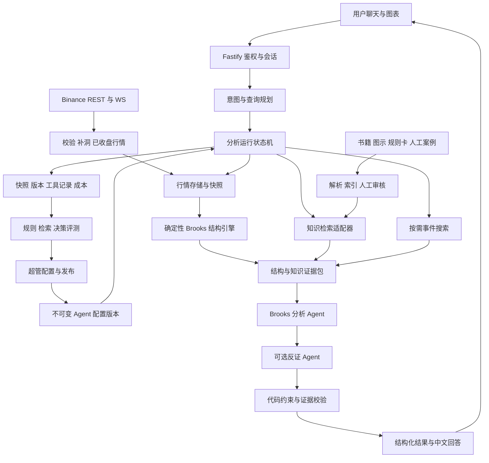

# Brooks 加密市场研究 Agent：技术架构与落地方案

> 状态说明：本文是 2026-09-30 的初版设计方案，调研结论与问题清单仍然有效；规范性内容已被 `docs/specs/` 下的最终方案替代。章节映射如下：
>
> - §3 总体架构 → `docs/specs/architecture.md`
> - §4 行情与时间一致性 → `docs/specs/market-data.md`
> - §5 结构引擎 → `docs/specs/brooks-engine.md`
> - §6 知识库与 RAG → `docs/specs/knowledge-rag.md`
> - §7 查询规划与 §8 Agent 编排 → `docs/specs/agent-orchestration.md`
> - §9 输出契约 → `docs/specs/perpetual.md` 与 `docs/specs/event-contracts.md`
> - §10 Admin 与存储 → `docs/specs/admin-security.md`、`docs/specs/api-storage.md`
> - §11 验证与 §12 迭代顺序 → `docs/specs/evaluation-deployment.md`

调研日期：2026-09-30。状态：设计方案，尚未实现。依据：当前 `biance-vision`、本机 `wushao-dev/lumen` 源码和文末的一手资料。本文不包含当前币价或实际买卖建议，也不代表已验证策略收益。

## 1. 技术判断与产品目标

RAG、查询改写、按需搜索、多 Agent 和管理员配置这五个方向合理，但还需要三个核心模块：确定性的价格行为结构引擎、可重放的行情快照、独立的评测与风险约束。

RAG 让模型能够检索和引用 Brooks 的知识；它不会把模型训练成 Brooks，也不能证明模型具备他的交易判断能力。产品应定义为「基于 Brooks 方法的加密市场研究助手」，通过真实样本逐步验证能力。

建议第一版限定为币安现货、BTCUSDT/ETHUSDT、1d/4h/1h 三个周期，支持教学、结构复盘、条件式交易计划与已有持仓的情景分析。暂不把下单纳入本轮架构的实现范围。其他交易对、合约和更多周期按评测结果扩展。

对于「现在该不该买/卖」，输出必须考虑市场类型、交易周期、当前持仓和用户确认的风险预算。持仓未知不能当成空仓；空仓用户的看空结论通常对应等待，已有现货持仓则可能对应持有、减仓或退出条件；卖出现货与建立空头仓位是不同操作。

Brooks 官方词汇表明确使用 20 根 EMA。因此可以保留 EMA20 为可选上下文，并另设仅 OHLC 的实验模式；现有 ATR 可作为工程上的波动归一化辅助。两种模式分别评测，不能把全部参数称为 Brooks 原文规则。[Brooks 官方词汇表](https://www.brookstradingcourse.com/price-action-trading-terms-glossary/)

## 2. 当前代码基础与优先缺口

| 当前模块 | 已有能力 | 下一步 |
| --- | --- | --- |
| `shared/src/{bars,swings,regime,signals,analyze}.ts` | 内外包、摆动、腿、市场状态、H/L 计数及其他结构规则 | 审核规则来源、因果性、参数与人工标注一致性 |
| `server/src/binance.ts` | Binance REST、实时流、断线重连、行情缓存 | 持久化已收盘 K 线、断流补洞、数据质量、统一截止时间 |
| `server/src/aiTools.ts` | `brooks_structure` 等工具、多轮调用、图表输出 | 结构化工具结果、必需证据闸门、受控分析流程 |
| `server/src/ai.ts` | 模型配置、用户档案绑定、系统提示、流式回答、RSS 新闻 | 配置版本、知识库绑定、查询规划、按需网页搜索 |
| `server/src/aiMemory.ts` | 会话和长期记忆 | 将用户确认的持仓/风险档案与自动提取的偏好分开 |
| 现有超管与 PostgreSQL/Drizzle | 用户角色、业务存储、审计基础 | 发布后的 Agent 版本、分析快照、评测与运行记录 |

已确认需要在扩展前解决的具体问题：

1. **历史状态会改变。** `shared/src/regime.ts` 的 `despeckle()` 读取 `types[i + 1]`，随后状态又参与信号和 Always In 计算。使用固定种子的合成 OHLC 做前缀比较，32 根数据时 index=31 为 `tight_range`，加入第 33 根后同一位置变为 `barbwire`。这是历史标签受后来数据影响的证据，不代表已测得实际收益影响。应改为因果状态机，或显式记录延迟确认时间。
2. **收盘约束没有在引擎入口统一执行。** `analyzeBrooks()` 直接消费数组，未检查可选 `closed` 字段；当前 AI 工具会按开盘时间和本机时钟剔除末根。应统一市场数据契约，REST 保留 closeTime 并结合交易所时间判断，WS 使用 `k.x`，入口拒绝未收盘数据或显式分离 provisional 分析。[Binance REST K 线](https://developers.binance.com/docs/binance-spot-api-docs/rest-api/market-data-endpoints)、[Binance K 线流](https://developers.binance.com/docs/binance-spot-api-docs/web-socket-streams)
3. **经验数字被写成通用先验。** `brooksText()` 包含 H2/L2「≈60%」等文字，`BrooksSignal.prior` 也预留经验概率。应保留原文上下文与出处，禁止把它们直接当成币种/周期的预测胜率；没有本地验证时输出概率为空。
4. **工具输出中的结构强弱被称为置信度。** 规则匹配强度、证据完整度、未来事件概率应分开表示。
5. **基础提示词称快照为唯一行情来源，已有工具又提供更多行情。** 应统一为带来源和时间的证据集合，并明确同一问题的截止时间、冲突处理和数据优先级。
6. **现有查询没有历史截止时间，工具循环中间文本直接流出。** 需要 `asOf`、运行状态和校验后的最终结果；进度可以即时展示，尚未审核的买卖结论不能先发送后校验。

现有合成自测可作为起点，但不足以证明 Brooks 语义、历史因果性或真实市场收益。

## 3. 总体架构



行情按时间查询并交给代码计算；书籍、概念与案例交给 RAG；模型解释已计算的结构、比较情景并组织回答。行情服务和知识库适配器分别隐藏上游实现。

第一版保留 TypeScript + Fastify + Drizzle + PostgreSQL 和现有 React/Vite。扩展领域模块即可，不必立即拆多个业务微服务或重写成 Python。行情采集、文件处理、批量回放按独立 worker 职责运行，服务形态随负载调整。

## 4. 行情与时间一致性

### 行情契约

每根 K 线至少保存：`venue`、`marketType`、`symbol`、`interval`、`openTime`、`closeTime`、OHLCV、`isClosed`、`eventTime`、`receivedAt`、来源和数据版本。价格存储使用精确 decimal；数值计算时显式处理精度与 tickSize。内部时间统一 UTC 毫秒，界面按用户时区展示。

按 `(venue, marketType, symbol, interval, openTime)` 幂等写入；处理重复、乱序、断流和 REST/WS 不一致。检查 OHLC 合法性、时间连续性和缺口，不能静默把缺失 K 线补成平盘。

每轮分析冻结 `snapshotId/asOf`。各周期只读取 `closeTime <= asOf` 的已收盘 K 线；4h/1d 最新可用收盘时间不同，应分别展示。当前成交价可以同时提供，但须标注为截至另一明确时间的实时信息，不能混入闭合 K 线信号。

实时行情的缓存有效期由业务 SLA 配置；结构缓存按最后已收盘 K 线失效。缓存 key 至少包含市场、交易对、周期、最后收盘时间、数据修订版本、规则版本和参数 hash。相同市场的结构事实可复用，个性化建议必须按用户隔离。

历史研究额外保存事件的 `publishedAt`、首次可用时间和 `ingestedAt`。新闻、案例结果、反思记忆均须遵循当时可知的时间；不能用今天的搜索内容解释过去的决策。未归档的历史事件证据应标记不可用。

### 大盘定义

第一版「大盘」明确定义为 BTC/ETH 多周期结构和币安现货 USDT 池的市场宽度、成交额、涨跌分布。它不是完整全球加密市场。交易池规则应排除稳定币对等不适用资产并版本化；历史评测使用当时的交易池，避免只选择今天还存在的币。

资金费率、OI、合约基差、BTC dominance、全市场总市值属于后续独立数据扩展，必须说明来源和覆盖范围，不能从现货 OHLC 推断为已知事实。

## 5. 价格行为结构引擎

采用三层：单根特征 → 市场结构/上下文 → setup 与后续确认事件。

| 结构 | 实现方式 | 必须定义的边界 |
| --- | --- | --- |
| 内包/外包线 | 比较相邻 high/low | 相等时如何归类、连续 ii/ioi、零波幅 |
| 摆动高低点 | 左右窗口确认或在线摆动状态机 | pivotTime 与 knownAt 分离；同根同时高低点的处理 |
| 腿 | 已确认交替摆动的状态机 | 未完成腿是 provisional；延伸不能覆盖旧决策证据 |
| 趋势/震荡 | 重叠、实体、HH/HL、LH/LL、突破跟随、可选 EMA | 全部只读取当时可用的前缀；保留 uncertain 状态 |
| H1/H2、L1/L2 | 回调内的连续计数状态机 | 计数重置、上下文、setup/触发/失效分离 |
| 双顶底、楔形、突破回踩、MTR | 带市场上下文的组合规则 | 相似价容差、跟随确认、失败案例与互斥解释 |

每个规则保存 `ruleId/version/sourceRefs/parameters/engineeringAssumptions`。官方定义、工程阈值和本地统计结论分别标记。例如实体占比、ATR 倍数、窗口和摆动尺度是待验证参数，不是普适常数。

事件至少保存 `patternTime/knownAt/triggerTime/invalidatedAt`、使用的 barIds、市场上下文和触发说明。摆动可以在图上画回较早的 pivot，但模型和回放必须到 knownAt 才能使用。H2 的出现、突破 H2 高点、随后是否成交是三件不同的事。

展示历史结构可以允许显式修订的 provisional 标注；已发布的分析证据采用追加事件或新版本，不覆盖旧记录。组合判断允许多空证据并存，不能强迫每段行情都产生交易信号。

### 因果性验证

对每个时间 t，仅输入 OHLC 前缀生成决策状态；增加后续 K 线后，检查已经确认且当时可知的事件是否改变。将完整批处理结果按 knownAt 截断，与逐根流式结果比较。展示用的回溯标注单独处理。

Freqtrade 的 lookahead-analysis 可借鉴其比较完整数据与切片运行结果的方法；它不能直接证明当前 TypeScript 引擎无泄漏，需要针对本引擎实现等价检查。[Freqtrade 前视偏差检查](https://docs.freqtrade.io/en/stable/lookahead-analysis/)

## 6. 知识库与 RAG

### 三类资料

1. **原始资料层**：有使用权的书籍、官方术语、教学材料和图表。保留版本、章节、页码、图号、原始片段及图像。
2. **规则卡层**：一个概念对应定义、成立条件、上下文、失效条件、容易混淆的概念、反例、关联 ruleId 和出处。LLM 可草拟，管理员审核后发布；正文更新不能自动修改线上规则代码。
3. **案例层**：真实 OHLC 窗口、人工结构标注、当时可见的多周期上下文和解释。决策时可见内容与未来收益/结果标签分开存储，防止案例检索泄漏。

书中图示与文字要相邻关联。OCR/VLM 提取用于知识理解，不把图片中的估算价格直接用作交易数据。未来图形案例检索先按结构特征过滤，再做语义/视觉匹配，避免只匹配蜡烛外观。

### 检索流程

`原问题 + 术语归一 + 已识别结构 → 权限/版本过滤 → 关键词与向量召回 → RRF → rerank → 邻接上下文 → 引用快照`

H2、L2、ii、ioi 等短词需要精确词项与同义词表，不能仅靠向量。工程起始值可设原问题加最多两个变体、候选约 30–50 条、精排后约 6–10 条，但最终由标注查询集选择，不能把它们当成最佳实践常数。相似度分数不能当成事实正确率。

检索分别覆盖支持依据和反例。每条引用保存 `documentVersion/chunkId/page/figure/sourceType/contentHash`，发布回答时冻结实际使用的片段。资料缺失或冲突时直接说明证据不足，不允许伪造页码。

完整商业书籍的入库与面向客户展示，需要明确材料的使用权和引用范围；这是管理员知识发布的数据要求。

### 如何复用 lumen

优先通过服务适配器复用 `lumen/rag`，使用其现有 PostgreSQL 元数据、Milvus 向量/BM25、S3 文件存储和解析队列。`biance-vision` 保留自己的用户会话与分析业务。知识库服务使用明确的服务凭证和服务端确定的授权范围，不把内部 token 或 dataset 权限决定交给浏览器/模型。

| 参考源码 | 可复用内容 | 本产品需要适配 |
| --- | --- | --- |
| `lumen/rag/src/parsing/client.ts` | file-parser-api 客户端、OCR/图片选项、取消与失败降级 | 书籍页码/图示保留；图示缺失时显示解析不完整 |
| `lumen/rag/src/chunking/` | 结构化切分、图片关联、位置元数据 | 按 Brooks 概念、例图、解释段组织 |
| `lumen/rag/src/retrieval/pipeline-v2.ts` | 文本/图片/词项多路召回、模型分组、RRF、精排 | 术语词表、规则版本和支持/反证检索 |
| `lumen/service/src/knowledge-bases/backends/` | 知识库后端接口与适配器 | 作为接入契约参考，核对鉴权和授权边界 |
| `lumen/service/src/chat/{query-rewrite,retrieval-query}.ts` | 查询改写、历史指代消解、失败回原文 | 其当前提示词偏故障查询，需替换成金融意图规划 |
| `lumen/service/src/chat/rag-store.ts` | 引用片段快照、指纹去重、溯源 | 在分析运行中绑定知识快照和 ruleId |
| `lumen/service/src/chat/agentic/orchestrator/delegate.ts` | 委派、并发、超时、取消、用量、运行记录 | 受控专家角色与同一行情快照 |

本次已检查这些入口源码，未修改或运行 Lumen。实际接入前仍需验证当前部署、认证、数据库隔离和契约版本，不能直接复制模块后假设可运行。

若第一版需要完全独立运行、没有可用的 Lumen RAG 环境，可实现相同适配接口，以 PostgreSQL + pgvector 和独立词项检索作为替代。pgvector 提供向量搜索，并可与全文检索结合；它本身不等于 BM25，中文分词与 H2 等术语需专门处理。两个后端二选一，不同时维护两套知识索引。[pgvector 文档](https://github.com/pgvector/pgvector)

## 7. 查询规划与按需搜索

先将对话解析为结构化计划：`intent/symbol/marketType/timeframes/asOf/horizon/portfolioContext/missingFields/requiredTools/retrievalQueries/searchNeeded`。

| 用户问题 | 路由 |
| --- | --- |
| H2 是什么 | 概念 RAG，给规则、上下文与反例 |
| BTC 目前结构如何 | 实时快照、1d/4h/1h 结构、相关概念检索 |
| 我有 BTC，现在要不要卖 | 上述证据 + 已确认持仓/交易周期/风险预算 + 条件计划 |
| 上周那次突破为什么失败 | 明确历史截止时间、前缀行情、当时事件证据 |
| 今天下跌是不是因为某公告 | 行情事实 + 搜索核验事件；因果联系标为假设 |

问题里的币种、市场类型、周期和买卖方向不能因扩写而改变；保留原始问题和改写记录。不把「还能涨吗」改成寻找只支持上涨的证据。默认配置可以用于一般市场研究，个性化仓位与交易计划缺少必要信息时由产品对话补全。

概念问答无需搜索；只有事件核验、近期制度/产品变更或知识缺口需要网页工具。优先交易所/项目官方公告与直接发布的经济数据，媒体作补充。当前项目的 RSS 新闻聚合不能替代按问题搜索。

搜索结果保存来源 URL、发布时间、抓取时间与引用片段；搜索摘要需打开原页核验。外部页面是证据，不是工具执行指令。工具采用白名单、URL/重定向检查、超时、体积限制和租户范围检查。来源冲突时显示冲突，不靠多数投票确定事实。

## 8. Agent 编排

### MVP

采用一个 Brooks 分析 Agent + 固定研究状态机 + 代码风险/证据校验。概念问答和行情研究走不同分支。状态机保证需要行情的建议确实取得新鲜快照和结构证据，不完全依赖模型自发决定调用工具。

流程：`plan → snapshot → structures → retrieve → draft → validate → publish`。后端决定权限、最大调用数、运行时间、预算与降级。模型负责语义解释、必要的受控补检索和回答组织。

### 后续专家分工

- Brooks Analyst：解释结构、提出偏多/偏空/震荡情景。
- Countercase Reviewer：查反例、相反周期与结构失效条件，返回 evidenceIds 和明确异议。
- Event Researcher：按需核验近期事件，不能覆盖已验证的行情事实。
- Risk Reviewer：解释交易计划的风险；硬约束仍由代码执行。

各 Agent 接收同一个 `snapshotId/knowledgeVersion/configVersion`，结果返回结构化 claims 与证据引用。禁止各自无约束重新拉行情、互相递归委派或自由多轮辩论。初始只允许一轮反证，必要时一次有预算的修复；不以投票数量当成置信度。

TradingAgents 可参考其分析、正反研究、交易与风险角色分工；FinRobot 可参考其把确定性数值计算与模型解读分离的设计。它们的市场假设与实现需要适配，并不能证明 Brooks 方法在币安上的效果。[TradingAgents](https://github.com/TauricResearch/TradingAgents)、[FinRobot](https://github.com/AI4Finance-Foundation/FinRobot)

长任务持久化每一步、输入/输出、失败原因和费用，支持取消与恢复。简单流程先用 TypeScript 状态机；复杂恢复需求出现后再评估专门工作流框架。

## 9. 条件式建议与输出契约

建议由情景与约束产生，而不是把结构信号直接映射成买卖。允许 `wait/no_trade/insufficient_evidence`，以及依据用户持仓生成 hold、conditional_entry、reduce、exit 等状态。

每轮回答至少包含：

```ts
interface ResearchResult {
  runId: string
  snapshotId: string
  configVersion: string
  ruleVersion: string
  knowledgeVersion: string
  asOf: string
  venue: 'binance'
  marketType: 'spot' | 'perpetual'
  symbol: string
  horizon: string
  decision: 'wait' | 'hold' | 'conditional_entry' | 'reduce' | 'exit' | 'insufficient_evidence'
  marketRegime: string
  claims: { text: string; kind: 'fact' | 'interpretation'; evidenceIds: string[] }[]
  scenarios: { condition: string; response: string; invalidation: string }[]
  evidenceQuality: 'complete' | 'partial' | 'stale'
  probability: null | { event: string; horizon: string; estimate: number; sampleSize: number; calibrationId: string }
  missingInputs: string[]
}
```

价格、关键位、收益风险比和仓位上限由代码计算并引用 evidenceId。模型不能产生无法溯源的数值。如果没有用户确认的风险预算和持仓，不提供伪精确的个性化仓位比例。

针对已定义的单笔止损计划，可按「可承受损失金额 / 每单位到止损的损失（含估算费用）」计算数量上限，并受资金、tick/stepSize、流动性、最小名义金额及组合暴露约束；这是计划约束，不能保证跳空或滑点时实际损失不超预算。合约必须另加杠杆、保证金与强平约束后再启用。

校验器检查市场类型、数据时效、引用存在、已确认结构、价格单位、entry/stop/target 方向、必要用户信息和行动逻辑。失败可在预算内修复一次，仍失败则返回缺少证据。服务端核心规则不得被管理员追加提示词覆盖。

UI 显示截至时间、各周期最新收盘、结论、关键结构、支持/反证、条件与失效点，并支持点引用定位 K 线或知识原页。运行进度可流式展示，最终建议在校验后发布。

## 10. Admin、权限、记忆与存储

Admin 配置分为模型、知识、规则参数、专家角色、数据范围、检索策略、预算和输出模板。每次发布冻结不可变版本，已有 run 继续使用启动时版本；提供草稿、调试、评测、发布、回滚及审计。规则参数只能从已注册 schema 选择，任意提示词不能生成并上线可执行规则。

API Key 使用服务端加密存储或 Secret 引用，日志不记录完整敏感输入。用户绑定已发布 Agent 版本，服务端解析可用工具与知识库范围。保留现有 superadmin/user 角色即可起步，多租户再引入更细权限。

自动记忆可保存学习水平、关注交易对和偏好；持仓、资产规模、风险预算、交易周期采用用户确认的结构化档案，带更新时间与失效检查。旧的市场结论不能作为当前事实。投资结果反思属于待评测资料，不能自动修改生产规则。

建议新增逻辑实体：`agent_versions`、`knowledge_bindings`、`rule_versions`、`market_candles`、`market_snapshots`、`structure_events`、`analysis_runs`、`run_steps`、`evidence_snapshots`、`recommendations`、`user_portfolio_profiles`、`eval_runs`。这是领域划分建议，落地时按数据量合并或拆表。

分析、配置版本和审计应使用 PostgreSQL 为权威；现有 JSON 镜像不能继续充当多实例写入的权威。若关键存储不可用，保留只读行情或明确的非持久化教学模式，停止发布无法审计的个性化建议。

文件解析和批量评测可借鉴 Lumen 的 pg-boss；规模小时不必再引入 Redis/Kafka。监控聚焦断流/缺口、证据缺失、无效输出、运行失败、延迟、工具费用和检索质量。

## 11. 怎样验证「能力」

| 层次 | 评测方式 | 不能混淆的结论 |
| --- | --- | --- |
| 结构识别 | 人工逐根标注的真实案例、反例、边界样本；precision/recall、确认延迟；多位标注者记录分歧 | 合成用例通过不等于理解 Brooks |
| 因果性 | 全量/前缀/逐根一致性；多周期收盘对齐；不可变 knownAt 事件 | 画回过去的 pivot 不等于当时知道它 |
| RAG | 概念金标查询、Recall@K、排序、引用准确性、反例覆盖、无答案处理 | 检索相似度不等于胜率 |
| 对话 | 应调用工具而未调用、编造结构/数字、周期混淆、持仓未知、陈旧数据、越权与注入 | 回答流畅不等于建议合理 |
| 交易假设 | 冻结参数的滚动样本外回放，费用/滑点/成交约束、市场分层、paper tracking | 历史收益不等于未来能力 |

概率若需要展示，先定义可评测事件，例如「未来 N 根内先触及 +1R 还是 -1R」。明确 R、入场与无成交、超时、双触及的处理，分币种/周期/状态报告样本数、置信区间、Brier score 与校准；没有足够样本时保持 probability=null。

回放按时间分训练/开发/验证/封存测试，参数只在开发阶段选择；重叠标签的样本使用 purge/embargo 防止跨窗口泄漏。历史交易池须包含当时存在而后来退市的资产。

同一 K 线触及目标和止损时，OHLC 不提供先后顺序，需更细粒度数据或预先声明的保守成交规则。计入手续费、买卖价差、滑点、未成交与流动性；合约另计资金费率。参考 FinRL 的训练/测试/交易分离，而不在 MVP 引入强化学习。[FinRL](https://github.com/AI4Finance-Foundation/FinRL)

比较规则引擎单独、引擎+RAG、增加反证 Agent、增加事件搜索四个版本，以及买入持有、空仓和简单趋势基线。增加 Agent 只有在样本外质量改善且延迟/费用可接受时上线。

LLM 参数记忆也可能包含历史之后的知识：严格行情/规则回放与完整 LLM 历史模拟应分别报告；仅限制工具日期不足以证明完整无泄漏。最终能力证据需要发布前冻结版本，并做前瞻的模拟跟踪。上线门槛包括无已知前视路径、关键数值可溯源、陈旧/缺失数据正确降级；其他指标阈值由标注集和业务目标确定，不预设收益承诺。

## 12. 迭代顺序与验收产物

| 阶段 | 工作 | 可验收产物 |
| --- | --- | --- |
| P0：事实可信 | 修正因果状态与收盘边界；去固定概率；定义事实/结构/概率契约 | 前缀一致性报告、可回放结构事件、规则出处清单 |
| P1：知识可查 | RAG 适配器、图文入库、规则卡、引用快照；超管知识绑定 | 金标概念查询集、可定位章节/图示的回答 |
| P2：研究可用 | 多周期冻结快照、意图规划、条件计划、风险校验、发布版本 | 用户聊天全流程、证据链、缺失数据正确处理 |
| P3：效果可测 | 历史行情集、样本外回放、基线、费用和前瞻模拟跟踪 | 结构/RAG/决策独立报告与参数冻结版本 |
| P4：按收益扩展 | 有限反证 Agent、事件搜索、案例检索、更多资产与市场 | 单 Agent/多 Agent 的成本与质量对照 |

当前优先级：验证现有 Brooks 引擎的因果性与规则语义，同时通过适配器接入 Lumen RAG；再将二者串成可审计的研究流程。未经这些验证，不应把增加资料量、提示词长度或 Agent 数量当作交易能力提升的证据。

## 13. 外部参考的使用范围

- [Brooks 官方词汇表](https://www.brookstradingcourse.com/price-action-trading-terms-glossary/)：核对术语、H/L 计数、市场上下文与 EMA 用法；不替代完整材料和人工解读。
- [Binance REST Market Data](https://developers.binance.com/docs/binance-spot-api-docs/rest-api/market-data-endpoints) 与 [WebSocket Streams](https://developers.binance.com/docs/binance-spot-api-docs/web-socket-streams)：行情字段、K 线时间与收盘标记的契约。
- [TradingAgents](https://github.com/TauricResearch/TradingAgents)：专业角色和反证流程；不用其研究表现作为本产品表现。
- [FinRobot](https://github.com/AI4Finance-Foundation/FinRobot)：计算与模型解读分离、金融研究证据组织；其股票估值逻辑不能直接迁入现货价格行为。
- [Freqtrade](https://github.com/freqtrade/freqtrade) 与 [lookahead-analysis](https://docs.freqtrade.io/en/stable/lookahead-analysis/)：数字资产回放和前视偏差检查方法。
- [FinRL](https://github.com/AI4Finance-Foundation/FinRL)：训练/测试/交易分离；强化学习不属于第一阶段依赖。
- [pgvector](https://github.com/pgvector/pgvector)：独立部署时的向量存储备选；优先复用已存在的 Lumen 能力。

项目代码和公开文档会变动；落地时应固定所参考的 commit/依赖版本，并复核实际 API 与许可。
