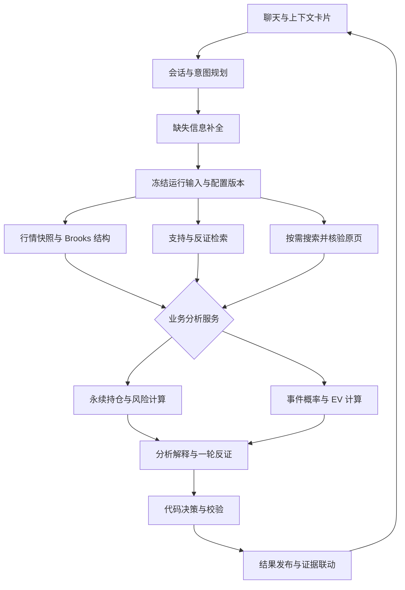

# Binance Brooks Agent 改进方案

> 状态：partial（P0 全部完成；P1 服务层/预测目标/训练治理完成；P2 会话层/契约 v2/配置冻结/SSE 落库/断点恢复完成；P3 验收进行中。2026-10-08 二轮实现，验收证据见 spec 索引与 smoke）
>
> 编写日期：2026-10-08。
>
> 本文基于当前实现的验收问题与已确认的改进方案，供其他实现 Agent 交接执行。本次仅沉淀文档，不执行方案、不修改业务代码，也不代表相关功能已经验收通过。

## 1. 目标与总体架构

目标是让用户通过聊天完成「了解概念、分析当前结构、评估永续持仓、研究到期涨跌、复盘历史结果」，每个结论都能追溯到行情、规则、计算和资料。

沿用当前 **React + Fastify + Postgres/pgvector + pg-boss + Python** 架构，保留已有 Brooks 引擎和 RAG。本轮不连接交易账户、不自动下单。

核心调整是：**增加会话层，把两类业务分析抽成独立服务，所有建议通过统一决策与校验服务发布。**



LLM 负责意图理解、资料解释、情景说明和反证；行情、结构、概率、盈亏、EV、仓位上限及最终动作由代码生成。增加角色数量不作为质量指标。TradingAgents、FinRobot 等开源项目只用于参考分工和可追溯输出，投资能力必须另行验证。

### 1.1 统一服务边界

研究流水线与公开 API 共用以下服务，避免出现「预测接口实现了，Agent 没调用」的情况：

| 服务 | 职责 |
| --- | --- |
| `MarketSnapshotService` | 读取正确窗口、检查质量、冻结行情 |
| `PredictionService` | 模型选择、特征计算、推理、预测记录冻结 |
| `PerpetualAnalyzer` | 持仓、费用、资金费率、风险及条件计划 |
| `EventAnalyzer` | 报价状态、到期目标、概率、EV、结算研究 |
| `DecisionPolicy` | 按产品规则生成动作与原因 |
| `ResearchValidator` | 校验数据、方向、数值、引用和版本一致性 |

`publish` 只保存已经通过校验的结果，不再临时决定买卖方向。

## 2. 先修正行情与两类业务决策

### 2.1 行情窗口与快照

修正目前的升序截断问题，并明确区分两种读取方式：

- **近期窗口**：取 `asOf` 之前最近 N 根已收盘 K 线，数据库降序取数，返回时恢复升序。
- **历史范围**：按 `from/to` 升序分页读取，训练集使用这一方式，不受单次 1,500 根限制。
- 两种方式都过滤未收盘数据；实时图表中的未收盘 K 线另行展示。

快照从「最后收盘时间指针」升级为「可复现的输入集合」：

- 保存实际使用的 K 线、价格类型、修订号、资金费率及参考价格。
- 小型元数据放 Postgres，完整输入包放 MinIO，保存内容哈希。
- 引擎、预测和结果图表都从快照读取，不能重新查询当前行情替代历史输入。

默认质量规则：

- K 线最新收盘时间距 `asOf` 不得超过「该周期长度 + 30 秒采集宽限」。
- 事件研究的实时指数参考价默认不得超过 5 秒。
- 必要窗口有缺口、时间错位或来源不匹配时，停止对应动作或概率输出，返回明确原因。
- 历史复盘检查历史窗口完整性，不按当前时间判定过期。

这些时间阈值是版本化工程参数，不是 Brooks 理论中的规则。

### 2.2 永续：用明确规则替代趋势投票

先统一方向类型：

```ts
type Direction = 'bull' | 'bear' | 'neutral'
type PositionSide = 'long' | 'short'

const positionDirection = {
  long: 'bull',
  short: 'bear',
} as const
```

研究周期采用固定映射：10m→1m、30m→5m、1h→15m、1d→1h、1w→4h 作为执行周期；高一级周期提供背景判断。多周期冲突必须显式输出，不能用平票偏多或简单多数票确定动作。

| 输入与结构条件 | 输出 |
| --- | --- |
| 持仓未确认或已过期 | 请求重新确认；允许一般结构研究 |
| 已确认止损/失效条件触发 | `exit` 条件研究 |
| 计划止损损失超过风险预算 | `reduce`，计算需减少数量 |
| 风险约束通过，结构支持持仓方向 | `hold`，列出失效条件 |
| 周期冲突或证据不足 | `wait` 或 `insufficient_evidence` |
| 无持仓，已确认 setup 触发且风险计划完整 | `conditional_entry`，另列 `side` |

不能仅凭「趋势偏多」输出开多建议。新仓计划必须包含入场条件、止损、目标或退出条件、仓位上限，以及费用假设。

计算层同步改进：

- 金额、数量和费用采用十进制运算，最终展示时才舍入。
- 杠杆用于保证金需求计算，不重复放大价格盈亏。
- 仓位上限计入费用与滑点假设，按交易对数量步进向下取整。
- 资金费率读取实际数据；未来费用明确为情景估算，不固定假设每天三次结算。
- 持仓复核同时展示「整笔交易净盈亏」和「从现在继续持有的增量风险」，避免把已发生费用重复当成未来成本。
- 强平价仅展示用户从 App 确认的数据。

### 2.3 事件合约：区分参与前与已提交订单

币安事件合约按到期指数价结算，平价退回本金，提交后不能提前平仓；官方目前列出的期限为 10m、30m、1h、1d，且仅通过 App 提供。因此一周保留为独立研究预测模式。[币安官方规则](https://www.binance.com/en/support/faq/detail/172247f1c4b8401ab106fb63900f3825)

报价增加：

```ts
type EventOrderState = 'preview' | 'submitted'
type StrikeStatus = 'preview' | 'locked'
```

- `preview`：研究是否具备参与条件。预览执行价和返还金额具有时效，默认 60 秒后要求刷新。
- `submitted`：固定真实执行价、到期时间和返还金额，研究剩余期限与到期结果；输出 `monitor / await_settlement / settled`，不能建议提前减仓或抛售。
- 新订单的执行价存在更新过程，因此预览分析必须明确使用的参考时间；已提交订单以 App 实际确认值为准。[执行价更新说明](https://www.binance.com/en/support/faq/detail/172247f1c4b8401ab106fb63900f3825)

事件链路必须真正接通：

```text
报价检查 → 指数价快照 → 到期目标预测
→ above/below/tie 概率 → EV → 条件判断 → 校验发布
```

三分支计算统一为：

```text
pWin + pLose + pTie = 1
EV = pWin × (totalPayout − stake) − pLose × stake
```

平价退款的净收益为零。`stake/totalPayout` 标注为「非平价条件下的盈亏平衡胜率」；存在平价概率时，不能直接拿无条件 `pWin` 与它比较。

参与前只有同时满足以下条件才允许 `conditional_entry`：

- 报价有效且币种、参考价类型、到期目标一致；
- 模型已发布且覆盖实际剩余期限；
- 概率和 EV 均可用，EV 严格大于零；
- 投入不超过用户确认的事件风险预算；
- 必要结构与反证检查通过。

任何条件不满足都返回原因，不能再因为「期限匹配」就建议参与。

## 3. 预测模块：纠正目标、训练与发布机制

### 3.1 明确区分预测目标

| 场景 | 预测目标 |
| --- | --- |
| 普通方向研究 | 指定期限后相对当前参考价的收益分布 |
| 事件订单研究 | 指定到期时刻的指数价相对固定执行价的高、低、平 |

保留现有分位数 GBM，但输出概率前必须使用执行价。

事件标签定义为：

```text
R = log(IndexPrice(expiryAt) / IndexPrice(asOf))
threshold = log(strikePrice / IndexPrice(asOf))
```

通过预测收益分布计算阈值处的概率，不能继续固定计算 `P(R > 0)`。

实现约束：

- 分位点固定为 `.01/.05/.10/.25/.50/.75/.90/.95/.99`，单调修正后构建 CDF。
- 校准集拟合单调的分布校准映射，测试集验证阈值概率。
- 阈值落在未验证的分布尾部时返回 `unavailable`，不能直接截成 0% 或 100%。
- 平价概率按照已核验的结算精度和规则计算；精度未知时不假设 `pTie=0`，事件 EV 保持不可用。
- 期限桶只用于选择模型族。训练和推理都包含实际 `remainingSeconds`，不能把完整 10 分钟预测直接用于剩余 8 分钟。
- 20% 容差保留；模型还必须验证该容差内的时长范围，否则不可用。

### 3.2 统一训练与在线特征

训练和预测调用同一个版本化特征函数：

- 收益、波动、ATR、区间宽度；
- 已确认 Brooks 结构与 setup/触发状态；
- 多周期背景；
- 事件研究的实际剩余时间；
- 所有结构都满足 `knownAt <= asOf`。

修复 `ret_240m` 在线只有 240 根数据却需要 241 根的问题。缺少必需特征返回不可用，不能静默补零。

模型注册表增加 `symbol/marketType/priceType/targetType/featureVersion/validatedDurationRange`。初版按交易对训练，禁止自动用 BTC 模型预测 ETH。

### 3.3 扩大历史范围并防止泄漏

训练按日期范围分页采集，默认：

| 期限 | 初始历史范围 | dev 最少样本 | calibration / test 各最少样本 |
| --- | --- | --- | --- |
| 10m、30m、1h | 12 个月 | 1,000 | 500 |
| 1d | 24 个月 | 180 | 90 |
| 1w 研究 | 5 年 | 104 | 26 |

表中是初始工程门槛，验证样本按不重叠目标窗口计数；数据不足时保持不可用，不能靠增加高度重叠样本满足门槛。

采用时间顺序划分、滚动验证和封存测试。跨分区的标签窗口全部 purge，分区间隔至少覆盖模型最大预测期限。同一个时间起点生成的多种期限样本必须属于同一分区。时间序列切分可参考 `TimeSeriesSplit` 的 gap 机制，但仍需自行检查标签结束时间。[官方文档](https://scikit-learn.org/1.6/modules/generated/sklearn.model_selection.TimeSeriesSplit.html)

记录训练、校准及发布评估使用的数据可见时间；历史模型选择同时检查模型发布时间，不能仅检查特征起点。

### 3.4 训练成功不等于发布

状态调整为：

```text
training → candidate → validated → published → retired
```

初版发布门槛：

- 样本量满足上表；
- Brier 优于仅用过去数据构建的频率基线，分块 bootstrap 的 95% 改善区间下界大于零；
- 可靠性曲线与分层校准通过；默认 ECE≤0.05；
- 90% 预测区间覆盖率在 85%–95%；
- 无已知泄漏、特征错配或参考价格错配。

这些门槛写入 `validationPolicyVersion`，不能通过提示词改变。Brier 与可靠性曲线需要一起报告，Brier 本身不能单独证明校准良好。[概率校准文档](https://scikit-learn.org/stable/modules/calibration.html)

分钟指数行情只能支持对应分辨率的研究估算。增加官方实时流中的指数价采集用于后续细粒度研究；它与 App 真实订单结算仍分别保存。不能把分钟代理标签直接升级为真实订单预测能力。[指数价实时数据来源](https://developers.binance.com/en/docs/products/derivatives-trading-usds-futures/websocket-market-streams/Mark-Price-Stream)

## 4. 补齐聊天、Admin 配置与 UI

### 4.1 会话与意图规划

新增 `conversations`、`conversation_messages` 和版本化结构上下文，保存币种、场景、期限、持仓引用、报价引用及信息来源。

路由支持六类意图：

| 意图 | 必要流程 |
| --- | --- |
| 概念问答 | RAG 与反例解释 |
| 当前结构 | 新行情快照、结构、相关知识 |
| 永续持仓 | 结构、已确认持仓、风险计算 |
| 事件研究 | 报价状态、预测目标、概率与 EV |
| 历史复盘 | 历史 `asOf`、当时可见证据 |
| 新闻归因 | 行情事实、搜索、原页核验 |

自然语言提取结果通过共享 schema 校验。持仓数量、方向、报价和风险预算等信息先展示确认卡；未经确认不得写成真实持仓。

追问继承结构化上下文。例如「如果杠杆改成 20 倍呢」生成新的假设研究，不覆盖已确认持仓；「现在呢」创建新快照；查看原回答仍使用原快照。

公共接口增加：

| 接口 | 行为 |
| --- | --- |
| `POST /api/conversations` | 创建会话 |
| `GET /api/conversations/:id/messages` | 分页读取消息与关联结果 |
| `POST /api/conversations/:id/messages` | 接受问题，返回消息、run 或待补全状态 |
| `PATCH /api/conversations/:id/context` | 保存用户确认的上下文 |

保留已有 `/api/research/runs`，供结构化入口和测试使用，两个入口调用同一服务。写入接口支持幂等键；会话、持仓和报价都执行用户归属检查。

### 4.2 结果契约

新增 `schemaVersion: 2`，产品负载改为严格的判别联合，替代任意 `record`：

- 永续：方向、条件计划、风险、费用、持仓时效；
- 事件：订单状态、执行价、到期目标、三分支概率、EV；
- 方向研究：期限分布与研究模式标识；
- 教学：解释及引用。

概率附带 `predictionId/modelVersion/targetType/referenceType/calibrationId`。不可用原因使用稳定代码，例如 `stale_market / missing_quote / unvalidated_horizon / target_mismatch`。

LLM 输出结构化解释和 `evidenceRefs/metricRefs`，后端装配数值。模型不能新增概率、修改 EV 或覆盖代码动作。

### 4.3 Admin 与运行可靠性

创建 run 时冻结发布版本的完整配置，包含：

- 能力、角色模板、工具白名单；
- 知识版本和检索参数；
- 规则参数、模型发布指针、决策策略；
- 预算与内容哈希。

角色执行、RAG 和预测全程使用该运行配置。删除工作进程中永久缓存「当前版本」的行为，已有 run 不受新发布影响。

修复草稿编辑：数据库更新条件必须包含 `status='draft'`；发布、指针更新和审计在同一事务完成。

默认运行预算：6 次 LLM 调用、20 次工具调用、2 次搜索、60 秒执行时间、0.25 USD 费用上限；属于可版本化工程默认值。调用前预留预算，调用后记录实际用量；模型费用表缺失时禁止假装能执行费用上限。

默认一轮反证、最多一次解释修复。数值和数据错误必须由代码处理，不能让 LLM「修复」概率。

`run_steps` 保存阶段输入、输出、版本和用量。worker 使用运行租约，从最后成功步骤恢复；预测、证据写入和发布都幂等。SSE 事件落库，支持游标重连，避免重启后进度丢失。

### 4.4 UI 调整

保留现有深色工作台，右栏改成真正的消息流：

- 左栏：会话与研究历史；
- 中栏：当前或历史快照图表，明确标识模式；
- 右栏：问题、补全卡、进度、结果、支持与反证；
- 移动端：图表、对话、证据三标签。

永续展示风险与条件计划；事件展示「参与前/已提交」、固定执行价、倒计时和 EV 可用状态。一周放入「方向研究」，不并列冒充实际事件产品。

点击结构证据定位 K 线及 `knownAt`；点击知识引用打开原文页码。切换 run 清空旧引用并忽略旧请求返回，防止串用证据。

## 5. 交付顺序、迁移与验收

### 5.1 四个交付阶段

| 阶段 | 内容 | 完成标准 |
| --- | --- | --- |
| P0 | 行情窗口、方向映射、决策门槛、不可变版本 | 已发现的错误不再复现 |
| P1 | 统一产品服务、预测目标、训练与发布治理 | 两类研究链路贯通；不可用状态正确 |
| P2 | 会话、路由、补全、Admin 执行、证据 UI | 用户通过连续对话完成两类研究 |
| P3 | 回放、恢复、浏览器与真实服务验收 | 完整验收报告可复现 |

P0 完成前先阻止当前不满足门槛的事件参与建议。

数据库采用增加字段和新表的迁移方式。旧模型统一转为待重新验证，不能自动转成 `published`；旧预测保留并标注旧目标，不能追溯改写成执行价预测。旧结果保持原样，通过版本兼容层展示。

### 5.2 必须新增的业务验收

| 用例 | 预期 |
| --- | --- |
| 库中 2,000 根 K 线请求最近 400 根 | 返回最新窗口 |
| 修改实时库中的历史 K 线 | 已发布快照结果不变 |
| 多单遇到支持多头的结构 | 不因 `long/bull` 类型错配减仓 |
| 周期方向打平 | 显示冲突，不默认偏多 |
| 风险预算超限 | 输出减仓数量或阻止新仓条件 |
| 事件没有概率、负 EV 或零 EV | 禁止 `conditional_entry` |
| 现价100、执行价105、到期103 | 上涨研究与事件胜负明确区分 |
| above/below/tie 及退款 | 概率和 EV 复算一致 |
| 完整10m与剩余3m | 不复用预测 |
| 已提交事件订单 | 不出现提前平仓动作 |
| 一天、一周样本不足 | 明确不可用，不伪造结果 |
| 追问「改成20倍」「现在呢」 | 正确继承上下文并新建研究 |
| 发布/回滚配置，旧 run 继续运行 | 各自使用冻结版本 |
| worker 重启、重复投递、SSE 重连 | 无重复结果，可恢复 |
| 普通用户访问他人会话或 Admin | 拒绝访问 |

保留现有类型、引擎、因果性和计算检查，增加产品决策集、会话集、样本外预测集及浏览器端到端测试。前视检查可参考 Freqtrade 对完整数据与截断数据的差异验证方式。[官方说明](https://www.freqtrade.io/en/stable/lookahead-analysis/)

最终验收分别出具：

- **功能报告**：两类业务、聊天、配置、引用和恢复是否满足方案。
- **统计报告**：哪些币种、目标、期限和数据分辨率已经验证，哪些仍不可用。

功能完成不代表所有期限的模型都能通过统计发布门槛。

### 5.3 文档、技能与知识资料交接

执行本方案时更新现有市场、永续、事件、预测、编排、UI、Admin 和评测 spec，新增会话及决策策略 spec；维护已有四个 SKILL，加入上述回归用例。原始方案保留，新方案与实际完成状态通过 [spec 索引](specs/README.md) 管理，`verified` 必须附验收证据。

建议新增的分项 spec：

- `docs/specs/conversation.md`：会话、意图路由、上下文、补全及 API 契约。
- `docs/specs/decision-policy.md`：两类业务动作域、决策门槛、不可用状态及回归矩阵。

Brooks 知识继续使用规则卡、案例和版本化引用；规则保留来源与工程假设。官方资料入口保留 [Brooks Trading Course](https://www.brookstradingcourse.com/)，商业书籍及会员资料通过有使用权的上传文件导入。

相关已有资料：

- [初步架构方案](brooks-agent-architecture.md)
- [正式 spec 索引](specs/README.md)
- [Brooks 资料入口](references/brooks-sources.md)
- [知识库导入清单](references/knowledge-source-manifest.json)
- [金融 Agent 架构参考](references/financial-agent-patterns.md)
- [币安产品与 API 参考](references/binance-products-and-apis.md)

以上外部规则链接在设计时核验于 2026-10-08；实现时复核产品规则、数据接口和实际参考精度。本文中的代码片段是设计示意，门槛数字是初始工程配置，不能当成 Brooks 原文经验或本系统已验证的投资收益证据。
