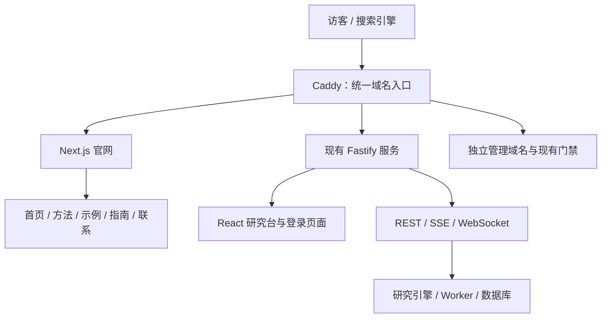
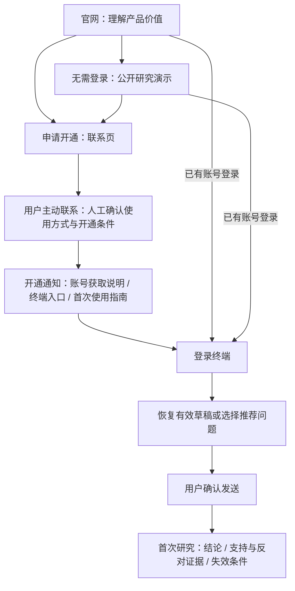

# Biance Vision 官网与 Next.js 渲染架构改进方案

> 状态：implemented（首版已实现，本地验收中；尚未部署，实际用户试用待执行）
>
> 日期：2026-10-23
>
> 修订：2026-10-23 两轮技术审查完成并定稿；随后按商业链路审查补齐新客入口、联系开通、中断恢复与终端首次使用。架构、部署边界和 W3 排期保持不变。2026-10-24 在 W3-S4 提交 `a3d4e46` 后开始集成，进度及新增人工开通需求见 §10。
>
> 本文保留定稿设计与历史审查记录；当前实施差异见 §10 和正式规格，部署及未执行的验收仍须单独完成。

## 1. 目标与架构

建设一个中英文公开官网，承接完整的 **吸引访客 → 理解价值 → 建立信任 → 联系开通 → 登录终端 → 完成首次研究** 链路。定位为：**以价格行为和可追溯证据为基础的 AI 加密市场研究工具。** 官网承担内容展示与意向客户转化，终端交付实际研究价值。

终端未来面向付费使用，本期通过人工联系与开通承接意向客户。不宣传永久免费，不编造价格、试用额度或响应时限；不增加在线支付、自助注册、CRM、申请数据库或匿名 AI 调用。各阶段都要有明确的下一步与中断恢复入口，不能以登录成功代替首次使用完成，也不能以进入终端代替付费成交。

采用 **Next.js App Router 建设官网，现有 React 研究台继续独立运行**。Next.js 是 React 官方推荐的框架之一，支持按页面选择静态生成、服务端渲染和客户端交互。[React 官方说明](https://react.dev/learn/creating-a-react-app)

本方案采用 Next.js 16.4.x 受支持的最新安全补丁、兼容的 React 19.3.x、TypeScript 和现有 Node.js 22；官网独立管理依赖，研究台维持 React 18。2026-10-23 查询 npm 时版本为 Next.js 16.4.2、React 19.3.1，这是核验记录，不是禁止升级的架构契约。安装时将所选确切版本写入 lockfile；补丁升级经兼容和构建回归后发布，安全公告要求跨版本升级时重新评估版本线。



**渲染方式按内容划分：**

- 官网正文、导航、指南、示例说明：使用 Server Components，构建时生成完整 HTML。
- 示例切换、证据高亮、问题输入、移动菜单：使用小范围 Client Components。
- 实际 AI 对话、实时行情、K 线和个人研究：继续由现有研究台处理。
- 官网首版内容随代码维护，更新后重新构建；不增加数据库、CMS 或匿名 AI 调用。

这里采用的是支持服务端渲染的架构；首版以预先生成页面为主，减少每次访问的计算成本。Next.js 官方也建议按交互和浏览器 API 的需要划分服务端与客户端组件。[组件边界说明](https://nextjs.org/docs/app/getting-started/server-and-client-components)

## 2. 官网的信息与视觉设计

视觉遵循已确认的方向：**首屏是精致产品舞台，向下滚动逐步进入金融终端风。**

参考 [Linear 官网](https://linear.app/) 的产品界面演示与分段叙事，以及 [TradingView 官网](https://www.tradingview.com/) 的图表、市场与研究内容组织方式，将其转化为本产品自己的表达。

### 首页从上到下的内容

| 区块 | 展示内容 | 交互与目的 |
| --- | --- | --- |
| 顶部导航 | 品牌、产品方法、研究示例、使用指南、联系、语言切换 | 右侧固定提供“已有账号登录”和“申请开通” |
| 首屏产品舞台 | 大标题、价值说明、悬浮研究界面 | 主按钮“查看研究演示”，次按钮“申请开通”；新客无需先登录 |
| 产品能力摘要 | 行情结构、支持与反对证据、条件与失效点 | 用具体能力建立理解，避免空泛口号 |
| 可交互研究演示 | 图表、关键价位、研究结论、证据卡 | 逐渐转入专业终端感，允许切换案例和高亮证据；结尾以“申请开通”承接 |
| 三种使用场景 | 结构研究、持仓复查、事件报价研究 | 解释适用问题、需要的输入和得到的结果 |
| 研究方法 | 行情快照 → 结构分析 → 证据与反证 → 校验 → 条件结论 | 展示结论如何产生，链接到方法详情 |
| 知识与指南 | 入门、读懂证据、价格行为、事件报价 | 提供可以被搜索、阅读和分享的实用内容 |
| FAQ 与最终引导 | 如何开通、是否实时、示例与实际研究区别、支持范围 | “申请开通”与“已有账号登录”；说明人工开通步骤 |
| 页脚 | 导航、联系方式、简短产品边界说明 | 提供稳定的联系与返回入口 |

**首屏建议文案：**

> **把市场结构，变成有依据的研究判断。**
>
> 结合 Brooks 价格行为、行情快照与支持和反对证据，理解当前结构、关键条件和失效位置。

英文对应：

> **Turn market structure into evidence-backed research.**

首屏研究界面采用真实产品布局的简化演示：左侧图表、右侧结论与证据，下方保留标为“准备你的研究问题”的问题输入区。正文和主要按钮立即可见，不等待动画播放完成。公开演示与问题准备区均明确自己的用途，不显示正在实时生成研究的假状态。

### 视觉规范

- 延续现有深蓝黑背景、青色强调和少量紫色环境光；红绿仅用于价格与方向表达。
- 首屏采用大字号、宽留白、细网格、柔和光晕和轻微界面浮起效果。
- 中段收紧布局，增加等宽数字、图表坐标、价位线和证据标签；背景与导航保持连续。
- 使用 CSS Modules；动效以 CSS 和 IntersectionObserver 实现，首版不引入 WebGL、粒子系统或自动播放视频。
- 进入视口时短距离淡入；不劫持滚动、不强制自动轮播。移动端取消倾斜与悬浮效果。
- 小于 760px 时演示区改为“图表 / 结论 / 证据”标签切换，主要按钮保持可见且不遮挡内容。
- 所有状态同时使用文字或图标表达；支持键盘操作、清晰焦点和减少动态效果偏好。[W3C 动效指导](https://www.w3.org/WAI/WCAG22/Understanding/animation-from-interactions.html)

### 公开页面

中英文使用 `/zh`、`/en` 两组网址，页面一一对应：

- `/zh`：官网首页。
- `/zh/methodology`：方法、研究流程、数据时间、证据和失效条件。
- `/zh/demo`：完整可交互示例。
- `/zh/guides` 与 `/zh/guides/[slug]`：指南列表和文章。
- `/zh/contact`：申请开通与联系。

首版指南固定包含：首次使用、读懂研究结果、价格行为与上下文、事件报价填写。其中首次使用指南固定为 `/zh/guides/getting-started`，英文为对应 `/en/guides/getting-started`，用于开通后的人工通知与异常恢复。每篇都提供正文、示例、相关内容、“进入研究台”和“申请开通”的明确入口，未有账号者不必先进入登录页。

### 示例内容

先交付三组明确标注的教学演示：

1. 趋势回调：如何同时阅读支持证据与失效条件。
2. 区间突破：如何识别反对证据和假突破风险。
3. 等待确认：证据不足时为什么应保留“等待”结论。

点击证据时同步高亮图表位置；点击关键条件时展开解释。核心说明以 HTML 输出，图表用 SVG 呈现，禁用 JavaScript 后仍能阅读案例。

所有示例固定显示“教学演示，非实时研究”。数据模型区分 `illustrative` 与 `historical`；后续真实复盘需补齐数据来源、市场时间和审核信息后才能发布。首版不展示模拟收益、胜率或虚构用户评价。

演示结尾明确说明：“开通后可针对自己的市场问题发起研究 / Once access is enabled, you can research your own market questions.” 提供“申请开通”和“已有账号登录”；不强制看完全部案例或阅读指南后才能联系。

页脚与示例页明确展示双语说明：“仅供研究与教学，不构成投资建议 / For research and education only. Not investment advice.”

## 3. 从官网进入系统的完整路径

### 路径与入口约定



上述是可选择的路径，不是必须依次通过的关卡：新客可随时联系，已有账号可直接登录。公开页面不探测会话，入口文案及正文不随登录状态变化；会话识别在进入现有登录与终端链路后完成。

| 入口位置 | 中文 / 英文文案 | 目标与行为 |
| --- | --- | --- |
| 首页主按钮 | 查看研究演示 / View research demo | 对应语言 `/demo`，无需账号 |
| 首页次按钮、演示结尾及其他内容的开通入口 | 申请开通 / Request access | 对应语言 `/contact`，说明人工联系开通 |
| 顶部及内容中的账号入口 | 已有账号登录 / Log in | 现有登录页；已有会话直接进入目标研究台 |
| 指南中的工具入口 | 进入研究台 / Open research terminal | 现有登录与终端入口，保留既定返回目标 |
| 问题准备区的账号入口 | 已有账号，带着问题进入 / Have an account? Continue with your question | 保存有效入口草稿，再进入登录与终端链路 |
| 问题准备区的开通入口 | 联系开通 / Contact us for access | 对应语言联系页，不将问题自动发送给外部联系人 |

### 已有账号

`已有账号登录 / 进入研究台 → 现有登录与会话检查 → /research?ui=dev`

已经登录的用户沿用当前会话识别，直接进入研究台。官网本身始终展示公开内容，不根据登录状态改变正文和缓存。

官网与研究台之间使用普通链接进行完整页面导航，避免 Next.js Router 与 React Router 接管对方的页面。

### 准备问题与短时交接

首页演示区下方提供“准备你的研究问题”轻量输入区，默认示例：

> 帮我分析 BTC 当前结构，列出支持、反对证据和需要等待的条件。

用户可编辑问题，选择现货或永续。已持账号者点击“已有账号，带着问题进入”；尚无账号者点击“联系开通”。不把所有访客都直接送进缺少账号的登录表单。

- 在同域、同标签页的 `sessionStorage` 保存一次性入口草稿。
- 草稿只含问题、场景、交易对、期限、语言和创建时间，不含持仓、报价或私人会话标识。
- 登录后由研究台读取，有效期自 `createdAt` 起计 30 分钟，不因登录或联系开通重新计时。
- 已有非空草稿时，让用户选择是否替换；不静默覆盖。
- 恢复后由用户确认发送，登录和跳转本身不发起研究。
- 存储不可用时仍可正常登录，并明确提示重新输入问题。
- 问题正文不放入 URL、访问日志或公开页面。

草稿仅用于同域、同标签页、30 分钟内的短时跳转恢复，不保证跨天、跨设备或关闭标签页后的恢复。官网到登录页、终端的导航保持同标签页；外部联系另开页面，不延长草稿有效期。

入口草稿使用独立 key `bv.research-entry.v1`，不复用或直接覆盖研究台现有的 `bv.workbench.drafts.v1`。最小契约如下：

```ts
type ResearchEntryDraftV1 = {
  version: 1
  question: string
  scene: 'spot' | 'perp'
  symbol: string
  horizon: '10m' | '30m' | '1h' | '1d' | '1w'
  locale: 'zh-CN' | 'en-US'
  createdAt: number // Unix 毫秒；有效期 30 分钟
}
```

读取时校验版本、字段类型和枚举；损坏、过期或未来时间的记录直接清除。成功恢复或用户明确放弃后删除入口记录；需要替换已有草稿时，等待用户选择后再消费。首版默认 `perp / BTCUSDT / 1h`，使用官网当前语言；跨应用跳转保持同标签页。

### 联系开通与人工交付

官网与登录页统一提供“申请开通”或“联系开通”，进入对应语言的联系页。联系页完整展示：**联系说明需求 → 人工确认使用方式及开通条件 → 获得账号与入口 → 登录开始研究**。

联系页包含：

- 当前采用人工开通、未来面向付费使用的说明；未确定的价格、试用条件和处理时限不展示为既定承诺。
- Telegram 按钮明确标为“打开 Telegram 联系 / Contact on Telegram”，并提供复制用户名；外部网页使用新页面打开并保留官网，桌面与移动端均可复制渠道地址。
- 配置备用邮箱后，提供邮件联系和复制地址。
- 可复制的申请模板：使用目的、关注市场、希望使用的场景；由用户自行选择、复制和发送，不自动携带私人问题、持仓或会话内容。
- 已有账号登录入口、首次使用指南，以及联系前可读的工具支持地区与使用边界说明。

联系方式通过配置提供，暂不填写假账号。开发预览允许显示配置提示；正式上线检查必须验证至少一种真实联系渠道。复制失败时展示可手动选取的文本；Telegram 无法打开时保留可复制账号，已配置邮箱时展示备用渠道。网站不模拟未经实际提交的“申请成功”、审核中或开通完成状态；点击联系按钮不能算作申请已提交。

首版不增加注册、申请数据库、Telegram Bot 或自动发送消息。开通仍由现有人工机制完成，开通完成后的人工通知统一包含：

1. 账号获取及登录说明，不在 URL 中携带密码或其他凭据。
2. 固定的终端入口 `/login?ui=dev&returnTo=%2Fresearch%3Fui%3Ddev`，已有会话按既有逻辑跳过重复登录。
3. 对应语言的 `/guides/getting-started` 首次使用指南，以及遇到问题时的联系渠道。

即使隔天开通、换设备或已无草稿，用户也可以从固定入口登录，选择推荐问题开始研究；不能将人工交付依赖于仍然打开的官网标签页或浏览器临时草稿。

### 登录与中断恢复

- 登录页同时提供“联系开通”和“返回官网”。进入联系页或官网时不主动清空原返回目标与仍有效的入口草稿；同标签页返回登录页后可继续。
- 登录失败保留原返回目标及有效草稿，提供明确错误信息和重试；已有会话不要求重复输入凭据。
- 草稿过期、损坏、浏览器存储不可用或跨设备进入时，提供重新输入与选择推荐问题的入口；不显示空白欢迎区或无限等待恢复。
- 从联系页返回产品说明、演示、指南或登录页都可直接操作，不依赖站外软件发回回调。
- 各页面保持中英文的按钮含义、目标和场景术语一致；语言切换不把用户送到无关内容，也不暗示草稿可以跨设备同步。

### 终端首次使用

复用现有研究台欢迎区、场景说明与推荐问题，不另建一套强制新手向导。首次使用承接到实际研究结果，而非停留在“登录成功”。

- 有有效入口草稿：恢复场景、交易对、期限和问题，等待用户确认发送。
- 已有非空终端草稿：由用户选择保留或替换，不静默覆盖；放弃入口草稿后仍能继续原来的研究。
- 没有有效草稿：展示可编辑的推荐问题和简短场景说明；选择推荐问题只填入输入框，不自动提交或生成研究。
- 首次结果就近提供可折叠的阅读说明，解释结论、支持证据、反对证据和失效条件；不强制用户完成额外教程才能继续。
- 研究失败、数据不足或服务不可用时，沿用明确的原因与状态，并提供适用的重试、修改问题或返回首次使用指南的入口；不可用时不虚构结论或可执行重试。

公开官网继续不依赖研究运行服务。官网进程故障、终端服务故障和外部联系不可用分别处理：终端故障时公开演示及联系信息仍可阅读，官网进程故障时既有工具路径仍由独立上游承接。域名、Caddy 和宿主机仍是共享基础设施，不能据此承诺所有故障完全隔离，资源与路由验收继续保留。

## 4. 重构与部署边界

### 路由与兼容

官网与工具共用当前用户域名。**Caddy 默认分支固定交给 Next.js，Fastify 只接显式列出的用户页面、资源和接口；不得保留“其余全部给 Fastify”的配置。** 下表按用户域名处理优先级排列：

| 路径 | 归属与行为 |
| --- | --- |
| `/admin`、`/admin/*`、`/api/admin`、`/api/admin/*` | 用户域名始终 404，优先于 API 分流 |
| `/` | HTTP 302：先识别浏览器支持的语言，其次使用可信代理传入的大陆 IPv4 名单匹配，最后 `/en`；不读取会话 Cookie，禁止缓存 |
| `/api`、`/api/*`、`/ws` | 用户 Fastify；保留原始 Host / 客户端 IP 传递及 SSE 无缓冲语义 |
| `/dashboard`、`/research`、`/brooks`、`/movers`、`/alerts`、`/login`、`/register` | 用户 React 应用，页面路径精确匹配；查询参数不改变归属 |
| `/assets/*` | 用户 React 静态资源；缺失资源返回 404 |
| `/zh`、`/zh/*`、`/en`、`/en/*`、`/_next/*`、`/site-assets/*` | Next.js 官网与资源 |
| `/robots.txt`、`/sitemap.xml`、`/favicon.ico` | Next.js；分享图片统一放 `/site-assets/*` |
| 其余所有路径 | Next.js 的未找到处理，返回 HTTP 404，不能重定向到首页 |

管理域名使用独立站点块，不进入上述用户域名路由。当前 S1 的门禁为 Caddy + ADMIN_HOSTS；本方案排在 W3 收口后实施，届时以 S3 的独立 admin-api 与 S4 分权结果为基线，不重新引入已经退役的 ADMIN_HOSTS。主站管理路径 404、管理域名 Basic Auth 和账号用途隔离继续验收。

页面路径带尾斜杠的变体统一跳转至对应无尾斜杠路径；`/research/anything` 等未定义子路由不得作为 `/research` 页面放行。新增工具页面必须同时更新前端路由、边缘分流清单和对应回归。

**有意变更的产品行为：**

- 新增 `/dashboard`，迁入原 `/` 的大盘组件；同步修改系统内“大盘”链接，并增加使用普通链接的“官网”入口。
- `web/src/App.tsx` 的 `AuthedApp` 通配路由 `Route path="*"` 同步从 `Navigate to="/"` 改为 `Navigate to="/dashboard"`（保留 `replace`），防止仅修改导航菜单而漏掉客户端兜底；直接请求未知路径仍遵守服务端真实 404 规则。
- 直接访问旧收藏 `/` 的已登录用户，也会经 302 进入按语言规则选择的官网；不根据会话把根路径送往不同内容。用户可点击“进入研究台”，或将收藏更新为 `/dashboard`。
- 无有效返回目标的登录默认进入 `/research?ui=dev`，替代旧版默认 `/`；已有合法 conversation / run / ui 深链保持不变。
- `authReturnTo` 将显式旧返回目标 `/` 映射为 `/dashboard`，同时覆盖 query `returnTo` 和原有 location state 来源；延续同站路径校验，拒绝外站、协议相对和反斜杠目标。

Fastify 同时收紧用户 SPA 回退：只有上述已定义用户页面可以返回 `index.html`，未知页面和缺失资源返回真实 404；未定义 API 不回退 HTML，满足既有鉴权前提时返回 404，未认证时允许沿现有策略先返回 401。管理端自己的回退范围按 W3 完成后的独立入口处理，不能用用户端 HTML 兜底。

官网使用单一根布局和根 `not-found`，语言及指南 slug 在开始流式响应前完成存在性校验；不在公开布局放置会提前提交 200 响应的 loading / Suspense 边界。Next.js 在流式响应开始后才发现不存在内容时，可能保留 200，因此验收必须检查真实 HTTP 状态，不能只看 404 页面文案。[Next.js 未找到页面说明](https://nextjs.org/docs/app/api-reference/file-conventions/not-found)

地域策略按已确认方案执行：**官网全球公开；研究台、登录与 API 沿用现有策略。** 官网访问不经过工具鉴权和地域检查，也不会调用受保护接口。

### 代码组织

- 新增独立 `website` workspace，承载 Next.js 页面、双语内容和演示数据。
- 品牌资源固定放在零运行时依赖的 `packages/brand`（包名 `@biance/brand`），只导出 CSS 变量与 SVG 文件；不新增另一套组件库，不含 React、i18n、认证或业务代码。供官网与现有前端复用时保持系统原有样式覆盖顺序。
- 官网不直接导入 `@biance/shared-ui` 总入口，避免其浏览器语言初始化、认证和业务依赖进入服务端。
- 新增入口草稿契约；不调整研究 API、SSE 协议或研究结果结构。
- 官网联系信息与语言映射形成统一配置源，现有开通说明页链接至官网联系页。

现状核验：`@biance/shared-ui` 的 React / React DOM 18 位于普通 `dependencies`，并非 peerDependencies。直接复用会带来 React 版本和 hooks 运行时混用风险，但不能断言“React 19 项目安装它一定发生 peer 冲突”；本方案通过纯资源包避开这条依赖链。

### SEO 与运行方式

- 双语页面使用独立标题、描述、自引用 canonical、互相对应的 `hreflang`、正确的 `lang` 和分享卡片。`x-default` 对应同一内容的英文页面（首页为 `/en`，指南为对应英文文章），不把全部详情页指向一个首页。根路径 302 是本产品暂定默认入口的选择；301 本身不会必然造成 canonical 混乱。[Google 语言版本说明](https://developers.google.com/search/docs/specialty/international/localized-versions)
- Sitemap 仅包含公开正式页面；登录、工具与管理端设置禁止索引，鉴权继续承担访问控制。使用 `noindex` 的页面不能同时依赖 `robots.txt` 阻断抓取，否则爬虫可能看不到该指令。[Google 索引控制说明](https://developers.google.com/search/docs/crawling-indexing/block-indexing)
- 使用与内容匹配的 `WebSite`、指南文章和面包屑结构化数据。
- 官网不挂载会话探测、行情 WebSocket、Markdown 大包或实际研究组件。
- 使用 Next.js standalone Docker 镜像，新增独立 `website` 服务，由现有 Caddy 反向代理。同步更新 VPS、Oracle、开发启动器和 CI 发布流程。[部署输出说明](https://nextjs.org/docs/app/api-reference/config/next-config-js/output)
- 官网构建与运行均不依赖研究数据库；研究服务不可用时，公开介绍、指南和演示仍能访问。
- 同步更新架构与 UI spec，分别记录官网和研究台的边界。

### 部署模式与容量

| 方案 | 资源与能力 | 本期取舍 |
| --- | --- | --- |
| Next.js standalone | 新增 Node 常驻服务和镜像，框架统一处理页面路由、404，并保留未来按请求渲染能力 | 保留为本方案默认选择 |
| `output: 'export'` + Caddy file_server | 不增加 Node 常驻进程；完整正文与客户端交互仍可用，但重定向、安全头、静态文件解析和 404 由 Caddy 负责，不支持运行时 SSR / ISR / Server Actions | 当前内容全部可静态导出，属于可行的更省资源方案；不是 SEO 能力不足 |

保留 standalone 的理由是让官网路由与未来动态页面能力集中在框架内，而非首版已经需要逐请求 SSR。若容量验收不通过，暂停上线、修订为静态托管方案，不在部署时临时混用两种模式。[静态导出限制](https://nextjs.org/docs/app/guides/static-exports)

- 容量依据以 [统一路线](unified-roadmap.md) 的升配记录为准：2026-10-21 已升为 2C4G / 70G。历史 91% 磁盘占用是清理、扩容前记录，不代表当前使用率；本次未登录 VPS 实测。
- 官网容量规划先预留 256MiB 常驻、512MiB 峰值内存作为待验证预算，镜像大小以实际构建结果为准；审查中的 80–150MB / 150–250MB 是估算，不能作为承诺。构建在 CI 完成，VPS 只拉取和运行。
- 上线前记录 `docker stats`、`free -m`、`df -h` 和 `docker system df`，同时检查研究负载下的整栈余量；磁盘要能容纳新旧镜像切换与回滚，不能只看新增 website 镜像。资源不足则不切流。
- 发版验收通过后按 [既有磁盘维护纪律](admin-isolation-plan.md#14-长效机制治每次发版涨一堆的根) 清理未被容器引用的旧镜像；确认版本记录及 GHCR 可拉取后再清理，不删除数据卷。清理后的旧版本回滚可能需要重新拉取，不能宣称旧镜像一定仍在本地。

### 安全头与缓存边界

- Caddy 用户域名站点级的 HSTS、`X-Content-Type-Options: nosniff` 和 `Referrer-Policy: no-referrer` 覆盖官网和工具各分支，不能因分流移到某个上游后丢失。
- 官网 CSP 只作用于官网 HTML，包含同源资源、禁止 object、限制 base / form 来源和禁止被其他页面嵌入。采用官方无 nonce 的静态兼容基线：`script-src 'self' 'unsafe-inline'`、`style-src 'self' 'unsafe-inline'`，生产环境禁止 `unsafe-eval`，不加载第三方脚本；这不是严格禁止所有内联脚本的策略。
- CSP 的实施位置固定为官网专属的 `website/next.config.ts` 的 `headers()`，覆盖 Next.js 处理的响应（包括官网 404）；不得写入 Caddy 用户域名的站点级 `header` 块，避免套到 React 研究台、登录页、管理端或 API 上。站点级只保留上述既有通用安全头。
- 不使用逐请求 nonce，以免把预生成页面变成动态渲染；未来若要求严格 CSP，再单独评估构建期脚本哈希。W2 的 `CSP: sandbox` 与 iframe sandbox 是对不可信原文预览的隔离，不能复制给需要 hydration 的官网。[Next.js CSP 与渲染关系](https://nextjs.org/docs/app/guides/content-security-policy)
- 同域 `bv_session` 的 `Path=/` 意味着浏览器会把 Cookie 发给官网；官网不读取会话、不回显 Cookie、不输出 `Set-Cookie`，访问日志不记录 Cookie。响应正文不随会话变化。
- 首版不额外增加 Caddy 响应缓存层；以后引入 CDN / 共享缓存时，只对公开官网页面忽略会话 Cookie 区分缓存，验证无 `Set-Cookie` 和用户数据；工具、登录与 API 不进入公开共享缓存。

## 5. 仅官网使用 Next.js 时的 SEO 范围

**研究终端维持 React SPA，不妨碍公开官网开展 SEO。** 搜索引擎按可访问的 URL 抓取、渲染和索引内容；同一个域名下，公开官网可以返回完整 HTML，登录后的工具可以采用客户端渲染。无需为了官网的 SEO 把整个研究终端迁入 Next.js。[Google JavaScript SEO 说明](https://developers.google.com/search/docs/crawling-indexing/javascript/javascript-seo-basics)

| 目标内容 | 本期承载位置 | 是否需要研究终端 SSR |
| --- | --- | --- |
| 品牌名、产品介绍、使用场景 | 官网首页与方法页 | 不需要 |
| Brooks 概念、证据解读、操作指南 | 公开指南文章 | 不需要 |
| 演示案例与研究方法解释 | 公开示例页 | 不需要 |
| 后续真实历史复盘与公开报告 | 官网新增公开列表与详情页 | 不需要；发布脱敏后的独立公开版本即可 |
| 个人 AI 会话、持仓建议、账户内容 | 登录后的研究终端 | 本期不作为搜索收录目标 |

### 能方便完成的部分

- 在 Next.js 内集中维护页面元信息、语言 URL、Sitemap、分享卡片和状态码。
- 构建时输出页面正文和可跟随的链接，减少对爬虫执行 JavaScript 的依赖。
- 将所有公开知识组织为“首页 → 方法 / 指南 / 示例 → 相关内容”的站内链接结构。
- 上线后通过 Search Console 检查抓取、索引、搜索词与访问表现。

### 流量的实际限制

- 服务端渲染和静态生成解决内容交付与抓取基础，不保证收录、排名或访问量。
- 只有一个炫酷首页时，可覆盖的搜索意图有限；指南、方法解释和后续真实复盘是扩展非品牌搜索内容的主要载体。
- 登录后的内容不会因为官网使用 Next.js 自动变成可搜索内容。以后需要让某份研究被搜索发现时，应发布独立、审核脱敏后的公开页面。
- 动效不能延迟或隐藏正文；示例不能只剩图表或截图，要有可阅读的结构、证据与结论说明。
- 公开内容持续提供原创信息、明确来源和实际解释，比单纯增加页面数量更重要。[Google 内容质量指导](https://developers.google.com/search/docs/fundamentals/creating-helpful-content)

## 6. 交付顺序与验收

### 排期前置条件

**默认排期为 W3-S2 → S3 → S4 收口并验收后，再开始官网的集成改动。** 方案首轮核对时的已提交基线为 `4a6c0ec`，当时仅 W3-S1 已实现；该基线不包含 S2 存储与配置收敛、S3 双进程切流、S4 数据库分权。开工时以最新合并提交与验收记录重新确认进度，不将本段历史快照视为 W3 的实时状态。

- 视觉设计、文案和独立演示预览可先准备；不同时修改 W3 涉及的 Caddy、Compose、Dockerfile、release workflow、workspace / lockfile、认证存储与共享 UI 入口。
- 官网集成开始前重新读取 `unified-roadmap.md` 与 `admin-isolation-plan.md`，基于 W3 最终提交更新上游、静态产物、会话用途和测试入口；不能按 S1 单进程形态复制一份过时部署配置。
- 对上述公共文件采用同一时间单一变更批次；前一批合并、回归结束后再开始后一批，避免两个会话在同一工作目录交叉覆盖。

### 实施批次

**第一步：架构与页面骨架。** 在 W3 完成后的基线上，完成 Next.js workspace、品牌资源、双语路由、Caddy 分流及 `/dashboard` 兼容。

本批必须同时处理 `AuthedApp` 通配跳转与导航入口，并在官网自己的 `next.config.ts` 中配置 CSP；不能把官网策略加入 Caddy 站点级通用安全头。页面骨架即按 §3 区分新客演示 / 联系开通与已有账号登录，不先用一个统一登录按钮占位后遗留。

**第二步：官网与演示。** 完成首页全部区块、方法页、三组教学演示、四篇双语指南和联系页；同时完成双语按钮、演示结尾开通引导、联系与人工交付模板、复制失败出口及工具支持范围说明。先验收桌面首屏，再验收移动端与滚动节奏。

**第三步：转化与发布。** 完成登录返回、问题草稿交接与失效恢复、终端欢迎区和首次结果阅读说明、联系方式配置、SEO、构建和部署验证；按下列真实用户试用要求检查整条链路并修复阻滞点。

验收覆盖：

- [ ] 直接请求或禁用 JavaScript，仍可读取页面主标题、正文、链接、指南和示例说明。
- [ ] 中英文网址、语言切换、canonical、分享卡片和 Sitemap 正确；不存在的页面返回 404。
- [ ] 公网入口验证 `/unknown`、未知指南 slug、未支持语言和未定义工具子路径均为真实 404；缺失 `/assets/*`、`/_next/*` 资源不返回 HTML 200。另直连用户 Fastify 测试入口，确认绕过 Caddy 时未知路径也不落 SPA 回退。
- [ ] `GET /` 与 `HEAD /` 在已登录、未登录时均为 302、`Location` 按同一语言规则选择 `/en` 或 `/zh`（与登录态无关）；`/dashboard` 可访问原大盘，系统内“大盘”入口不再指向 `/`。点名核查 `App.tsx` 中 `AuthedApp` 的 `Route path="*"`：客户端兜底跳转为 `/dashboard` 且保留 `replace`，服务端直开未知路径仍为 404。
- [ ] 新增登录返回断言：缺省返回新研究台、query 和 state 的旧 `/` 均映射 `/dashboard`、已有 conversation / run / ui 深链保留、非法外站目标被拒绝。此组属于明确的产品行为变更，不能用修改旧期望掩盖入口隔离回归。
- [ ] 登录、已有会话、退出、会话过期、研究深链、两种研究 UI、SSE 和 WebSocket 正常。
- [ ] 官网问题经登录后恢复；不覆盖已有草稿，不自动提交，不创建匿名研究。
- [ ] Telegram 和邮箱入口、复制、无配置预览和正式上线检查均符合预期。
- [ ] 无账号的新访客可直接理解产品、查看公开演示并找到“申请开通”，不被迫先进入登录页；已有账号用户可跳过演示与联系环节直接登录终端。
- [ ] 首页主按钮、次按钮、演示结尾、指南、问题准备区和登录页的入口文案与目的地符合 §3 表格；中英文、桌面和移动端保持一致，不残留将新客统一送入登录的旧流程。
- [ ] 联系渠道无法打开、复制失败、登录失败、存储不可用、草稿过期及跨设备进入时，均有明确后续操作；联系方式未配置时阻止正式上线。
- [ ] 联系页说明人工流程和使用支持范围；人工通知模板包含固定登录入口、账号获取说明和首次使用指南，不含虚构处理时限，不依赖站外回调或仍有效的草稿。
- [ ] 在同标签页 30 分钟内验证问题、场景、交易对、期限的恢复；另用新浏览器会话模拟隔天开通 / 换设备，确认没有草稿仍可经固定入口选择推荐问题完成首次研究。
- [ ] 有非空终端草稿时可保留或明确替换；推荐问题只填入输入框，用户确认前不发消息、不创建研究；首次结果的四类阅读说明可折叠，异常时可重试、修改问题或阅读指南。
- [ ] 演示与实际研究的区别清晰可见；未确定的价格与试用条件不展示为承诺，不宣传永久免费。点击联系按钮不视为申请完成，登录或进入终端不视为付费成交。
- [ ] 邀请 5 名符合目标画像、未参与设计的用户试用；至少 4 名能无协助说明产品价值、完成演示至联系路径，并使用测试账号完成首次研究。记录各环节阻滞点，修复后复测；不得用技术自测或访问量替代此项。
- [ ] 从中国大陆及海外各选一个实际出口拨测官网（禁用缓存命中或同时确认请求确实到达目标版本），记录状态码及页面内容；同时对工具和 API 使用相同出口验证原地域策略，对管理域名验证独立门禁。不能只依靠“官网不经 Fastify”的架构推断判为通过。
- [ ] 公网官网和 404 响应均保留安全头；CSP 下演示、语言切换和草稿交接正常；确认 CSP 来自官网专属配置，未附加至研究台、登录、管理端或 API；带与不带会话 Cookie 的公开响应内容一致，均无 `Set-Cookie`，不误伤原文预览 CSP。
- [ ] 在 390px、768px、1440px 和 1920px 检查布局；验证键盘、焦点、减少动效及无横向溢出。
- [ ] 完成全仓类型检查、生产构建和针对路由、登录交接的浏览器回归。
- [ ] `pnpm admin:gate-check` 必须通过（当前基线 35 项）；W3 若退役 Host 门禁，测试应适配物理路由隔离并保留同等账号与用途隔离断言，不保留已退役实现作为假前提。
- [ ] `pnpm login:regression` 必须通过（当前脚本输出 16 项）；它主要覆盖服务端登录安全，并不替代本次新增的浏览器跳转断言。W3 后使用独立、无冲突的测试端口与测试库，不占用线上 admin-api 的 3201。
- [ ] `pnpm knowledge:access-check` 与完整 `pnpm release:gate` 必须通过；涉及数据库的测试在独立测试环境中执行，发布不允许通过 `GATE_SKIP_DB=1` 跳过所需回归。
- [ ] 性能以上线后移动端与桌面端第 75 百分位 LCP ≤ 2.5 秒、INP ≤ 200ms、CLS ≤ 0.1 为目标；上线前用实验室测试检查加载与布局，不能以一次评分代替真实访问数据。[Web Vitals 标准](https://web.dev/articles/vitals)

CI 无状态阶段运行类型检查、构建、门禁自测及可隔离的前端 / 路由回归；数据库相关套件在配置好的隔离集成环境或本地 release gate 中执行。测试数量仅记录当前基线，后续增加断言后以全部必需场景通过为准，不能固定总数而漏跑新用例。

上线先验证独立官网服务与容量，再对候选 Caddy 配置执行 `caddy validate`，通过后热加载分流；官网与前端路由变更使用同一版本发布，并按现有部署纪律安排容器切换窗口。回滚时同步恢复官网接入前、W3 已完成版本的镜像和路由配置，不退回 W3 之前的数据与认证形态。

本期默认保留 **Biance Vision** 品牌、管理员开通机制和现有业务后端；真实复盘发布、CMS、自助注册与公开实时行情属于后续扩展。

本次商业链路修订的文档完成标准是所有阶段、下一步和异常出口均有明确约定；实际吸引力与商业转化效果通过用户测试及上线反馈验证，不因设计定稿而宣称已经达成。

## 7. 本轮审查结论与事实修正

| 审查项 | 结论及本轮处理 |
| --- | --- |
| P0：未知路径归属 | 采纳。固定 Caddy 默认交 Next.js、工具路径显式匹配、Fastify 自身收紧回退，并补充流式 404 状态验证。 |
| P0：既有回归未点名 | 采纳。列入三套指定回归、完整发布门槛和独立的登录跳转断言。 |
| P0：与 W3 的公共文件冲突 | 采纳。官网集成排在 W3 S2/S3/S4 收口后，复核最终拓扑再改公共部署与认证边界。 |
| P0：旧根路径与新增大盘路由 | 采纳。将根路径固定 302、旧收藏落官网、默认登录目标变更列为有意产品变化并验收。 |
| P1：容量、部署方式、安全头和版本维护 | 采纳。保留 standalone，说明静态导出同样可行；补实测门槛、清理纪律、静态兼容 CSP 和补丁维护。 |
| P1：品牌资源落点 | 采纳建议中的零依赖资源包选项，固定为 `packages/brand`，不另建共享组件体系。 |
| P2：语言默认值、草稿、Cookie 与拨测 | 采纳。固定 302 / x-default、入口 key 与版本、会话缓存边界、双地域拨测及双语产品说明。 |

以下表述经过复核需要校正：

- **React 依赖类型**：shared-ui 使用普通 React 18 依赖，并非 React 18 peerDependencies；风险是混用依赖与浏览器副作用，不能写成“安装必然 peer 冲突”。依据：`packages/shared-ui/package.json`、`packages/shared-ui/src/i18n/index.ts`。
- **原方案路由表**：此前已列 `/robots.txt`、`/sitemap.xml` 和泛称官网图标；实际缺口是默认分支、精确匹配规则，以及未点名 `/favicon.ico`，本次均补全。
- **W2 CSP 的用途**：已落地的是用户侧证据原文预览的 CSP sandbox 与 iframe 双层隔离，不是可以直接复用的整个 admin 官网策略。依据：`server/src/research/runs/routes.ts`、`docs/specs/knowledge-rag.md`。
- **容量时间点**：总控路线已记录 2C4G / 70G 升配；历史 40G / 91% 和旧资源评估不可当作当前读数。精确现网占用与 website 增量仍需上线前实测。
- **302 与 canonical**：采用 302 是明确默认入口的产品选择；“301 必然导致 canonical 混乱”不成立。双语页面各自 canonical 与互指语言版本应独立正确配置。

2026-10-23 的该轮审查只修订设计文档；当时未修改业务代码、测试、部署配置或生产环境，也未执行上述运行时回归，清单保持未验收。

## 8. 复审定稿记录

2026-10-23 用户复审结论：修订稿通过审查，可以定稿。复审剩余三个实施细节均已纳入正文：

1. 点名 `AuthedApp` 的客户端通配路由目标改为 `/dashboard`，并纳入第一批实施和验收。
2. 官网 CSP 固定由官网的 `next.config.ts` / `headers()` 输出，不在 Caddy 站点级对工具统一施加。
3. 本文与 `docs/README.md` 状态统一为“已定稿，待 W3 收口后实施”。

本次定稿不触发官网实现或部署，也不覆盖其他工作中的 W3 代码；实施清单保持未勾选。

## 9. 获客与首次使用链路修订记录

2026-10-23 用户明确商业目标：终端未来是付费产品，现阶段以官网吸引、价值演示、人工联系开通和终端实际使用承接意向客户；本次只完善方案文档。

本轮已同步修订目标、首页内容表、公开指南入口、完整转化路径、实施批次与验收要求：

1. 新客优先查看无需账号的研究演示，再联系申请开通；已有账号保留直接登录入口，不强制经过获客流程。
2. 联系页、人工通知与固定首次使用指南衔接开通前后；补充联系不可用、复制失败、登录失败及草稿失效的恢复出口。
3. `bv.research-entry.v1` 契约及 30 分钟期限不变，明确跨天、跨设备和关闭标签页不保证恢复，缺少草稿时使用推荐问题继续。
4. 复用研究台现有欢迎区与推荐问题，用户确认后才提交；首次结果提供可折叠阅读说明并保留失败恢复路径。
5. 商业定位、真实用户试用与转化口径纳入验收；不引入在线支付、自助注册、CRM 或申请数据库，不改变已定稿的技术架构与 W3 排期。

文档索引同步记录本轮修订；方案仍为“已定稿，待 W3 收口后实施”。本轮仅更新本文与索引，未实施功能、未执行上线或用户试用，所有待实施验收项保持未勾选。


## 10. 2026-10-24 实施记录与域名确认

用户再次确认：沿用**既有用户域名 + 路径分流**，保留独立管理域名。当前系统地址只是部署现状，不是新增“终端专属域名”的配置契约；代码与交付链接使用相对路径，完整公开 origin 仅由 `WEBSITE_ORIGIN` 注入。无需新增用户域名、DNS 记录或证书。

- W3-S4 已提交后才修改 Caddy、Compose、Dockerfile、workspace 与 CI；admin 上游采用独立 3201，未重新引入 ADMIN_HOSTS。
- 新增 `website/`：React 19 / Next App Router、双语首页、方法页、三组原创教学演示、四篇双语指南、联系页；正文预生成，联系页服务端读取公开配置。官网不探测会话，不调用行情或研究服务。
- 根入口按后来确认的语言策略实施，替代首轮固定 `/zh`：Accept-Language 优先，可信大陆 IPv4 兜底，最后英文；固定语言 URL 保持不变。搜索抓取开放、GPTBot 训练抓取关闭；深入 GEO/SGO 已于本轮获授权并落实工程实现，详见 §11；收录、引用与真实用户验证独立待执行。
- `/dashboard` 承接原大盘；登录默认目标 `/research?ui=dev`，query/state 的旧根目标映射 `/dashboard`；工具导航使用 React Router，跨官网边界使用普通链接。登录语言从官网显式传入，同标签页联系绕行可恢复短时返回目标。
- `bv.research-entry.v1` 同标签页 30 分钟交接；问题最多 2,000 字，与终端输入上限一致。无现有草稿时只恢复输入，用户确认发送；草稿或历史上下文冲突时先选择，过期后仍可输入或选择推荐问题。研究正文不记录到 HTTP 请求体日志。
- 用户新增授权：管理端通过独立 API 开通普通用户、生成强随机密码、选择现有 AI 档案并设置累计/每日/每分钟限制，全部成功才显示凭据。复用原 AI 配置弹窗；不增加在线支付或自助注册。硬额度使用 PG 原子计数，在模型执行前判断，不能依赖浏览器或 JSON 计数。
- 管理端配置 Telegram / 联系邮箱后写入仅含公开字段的原子快照；Next 只读挂载该子目录，联系页刷新生效，无需访问管理 API。未配置 Telegram 时诚实显示占位，配置后提供按钮 + 复制用户名 + 桌面二维码；邮箱为用户提供的 `codevvvv9@gmail.com`。
- 交付模板包含用户名、密码、用户域名登录入口与指南。密码仅在本次交付保留，不进入浏览器持久化或 URL；重置会撤销 PG 会话，独立进程对后续受保护请求核验撤销状态。已受理研究或流式响应不会因额度耗尽被截断。

实施使用说明见 [website/README.md](../website/README.md)，验收及限制见 [本地验收记录](references/website-implementation-qa-2026-10-24.md)。§6 的完整部署、拨测及用户试用清单继续保持未勾选，不因本地检查通过而代填。


## 11. 2026-10-24 GEO/SGO 集成记录

沿用 §10 同域路径与独立管理域名，新增双语 `/about`、三个 `/demo/{trend-pullback,range-breakout,wait-for-confirmation}`、四个深入指南（`second-entry-h2`、`closed-candles-and-live-price`、`reviewing-perpetual-research`、`research-tool-checklist`），方法页与原四篇指南一并使用构建期 MDX 和显式双语内容清单。34 个公开 URL，默认未知路径继续交 Next 返回真实 404；不改变 `/dashboard`、研究 API、鉴权、SSE 或草稿契约。

新增页面沿用来源、目录、关联案例、联系开通与登录入口。默认搜索抓取规则分别覆盖专用爬虫，不承诺 AI 引用。站点验证 token 作为公开构建参数；官网专用日志使用独立 volume、公开路径白名单、14 天 / 20 MiB 上限，不记录终端或私人内容，不建立统计数据库。

`website/Dockerfile` 的 standalone 启动增加原生日志 preload，仍只有公开配置的只读挂载；与 W3 隔离边界一致。发布工件包含 runtime 目录。实际工程验证、可读性截图、12 题检查集和未观测事项见 [GEO/SGO QA](references/website-geo-sgo-qa-2026-10-24.md)；详细方案见 [GEO/SGO 计划](website-geo-sgo-implementation-plan.md)。未执行正式发布、站长平台提交或用户试用，完整发布门槛沿用既有要求。

补充依赖隔离：根 pnpm packageExtensions 为 React Router 6 的类型声明增加可选 `@types/react` peer，使终端固定解析自身 React 18 类型，避免安装 MDX 后隐式提升到官网 React 19 类型。两端运行时 React 版本不变。
